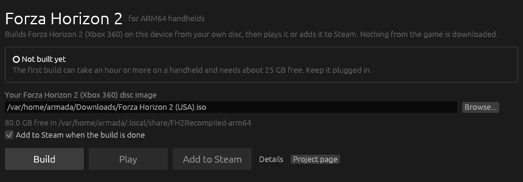
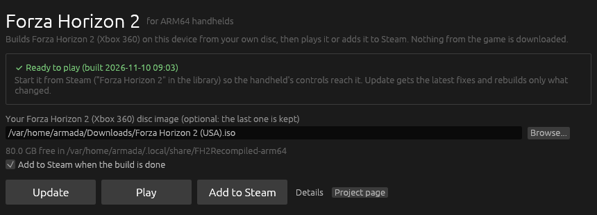

# fh2-recompiled-arm64

Play [FH2 Recompiled](https://github.com/gabrick75/fh2-recompiled), the
ahead-of-time recompiled Xbox 360 *Forza Horizon 2*, natively on Snapdragon
handhelds running [ArmadaOS](https://armadaos.dev/), such as the Retroid
Pocket 6.

  
  

Upstream ships Android APKs and an x86-64 Linux build. This repository adds the
missing piece: a native linux-arm64 build compiled on the handheld itself,
so it runs on ArmadaOS straight from Steam, with no Android layer and no
emulation of the CPU.

## Install

You need an ISO of your own **Forza Horizon 2 for Xbox 360**, USA edition
(title `4D530AA4`), and about 25 GB free.

1. In **Desktop Mode**, download `FH2Recompiled-Launcher-linux-arm64.tar.gz`
   from the [latest release](https://github.com/Ken5998/fh2-recompiled-arm64/releases/latest),
   extract it to your home folder and start `FH2Recompiled/fh2-launcher`.
2. Pick the disc image (the launcher looks in Downloads, ROM folders and SD
   cards) and press **Build**. Keep the handheld on its charger: the first
   build compiles the whole recompiled game and takes an hour or more.
3. Press **Play**, or start **Forza Horizon 2** from Steam: the handheld's
   controls reach the game only when Steam starts it. The launcher adds the
   shortcut without artwork; pick yours with SteamGridDB.

The disc image is read in place, never copied or extracted: only the three
executables the recompiler needs are taken out, plus the game's shader files
for a few minutes while the build makes the native renderer's shader library. Keep it where it is, or
build again after moving it. **Update** in the launcher pulls this
repository's fixes and rebuilds only what they touch.

## Settings and performance

`~/.local/share/FH2Recompiled-arm64/game/fh2.toml` holds the settings, preset
the way FH2 Recompiled's Android launcher sets up Snapdragon 8 Gen 2 phones:
30 fps limit, render scale 100 % of 1280x720, MSAA off, the scene in one pass,
car reflections over three frames, one game step per frame shown.

The game draws with FH2 Recompiled's native renderer, from a shader library
(`fh2_shaders.nfsp`) the build makes out of your own disc with DXC (built for
linux-arm64 in this repository's `shader-tools` release). On the RP6 it holds
a steady 30 fps with GPU and CPU to spare; the first couple of minutes run
slower while Turnip compiles and caches the shaders. A few shaders (the
D3D library's own, loose in the executable) only show up while playing: the
game writes them to `~/.local/share/FH2Recompiled-arm64/shader-dump`, and the
next Build or Update adds them to the library. Until then some scenes, night
lighting above all, have wrong colours. With
`FH2_RENDERER=emulated %command%` in Steam's launch options it uses the
emulated Xenos GPU instead: the faithful renderer, but about 15 fps there.

Keep the 30 fps limit. The game simulates 30 steps a second: at 60 fps
frames carry uneven motion, and below 30 with `fh2_ritmo_passos` on the game
runs in slow motion. Frame generation (`present_frame_gen`) adds a frame of
latency, so the car feels heavy.

If MangoHud or the Steam overlay flicker, the launcher can turn GPU
preemption off (kernel option `msm.enable_preemption=0`, then restart).

## How it builds

- `scripts/prepare.sh` checks out FH2 Recompiled at the commit in
  `upstream.json`, fills its `sdk/thirdparty` from the ReXGlue SDK release it
  is based on, and applies `patches/`.
- `scripts/build.sh ISO` does the rest on the handheld: the pinned LLVM
  toolchain and sysroot (`toolchain.json`), the recompiler, the code
  generation from your executables, the game (ARMv8.2, tuned for the RP6),
  `game/fh2.sh` and the Steam shortcut.
- CI builds the SDK and the game natively on an ARM64 runner in Fedora 44
  and cross-compiled on x86-64, with placeholder recompiled code, since no
  game files are ever involved here.

## Legal

This repository contains no game files, no code generated from the game and
no binaries built from it. The game is built on your device from a disc you
own. Forza, Forza Horizon and Xbox 360 are trademarks of the Microsoft group
of companies; this project is not affiliated with or endorsed by them.

## License

GPL-3.0, like FH2 Recompiled; the patches to its copy of the ReXGlue SDK are
BSD-3-Clause like the SDK. See [NOTICE](NOTICE).
